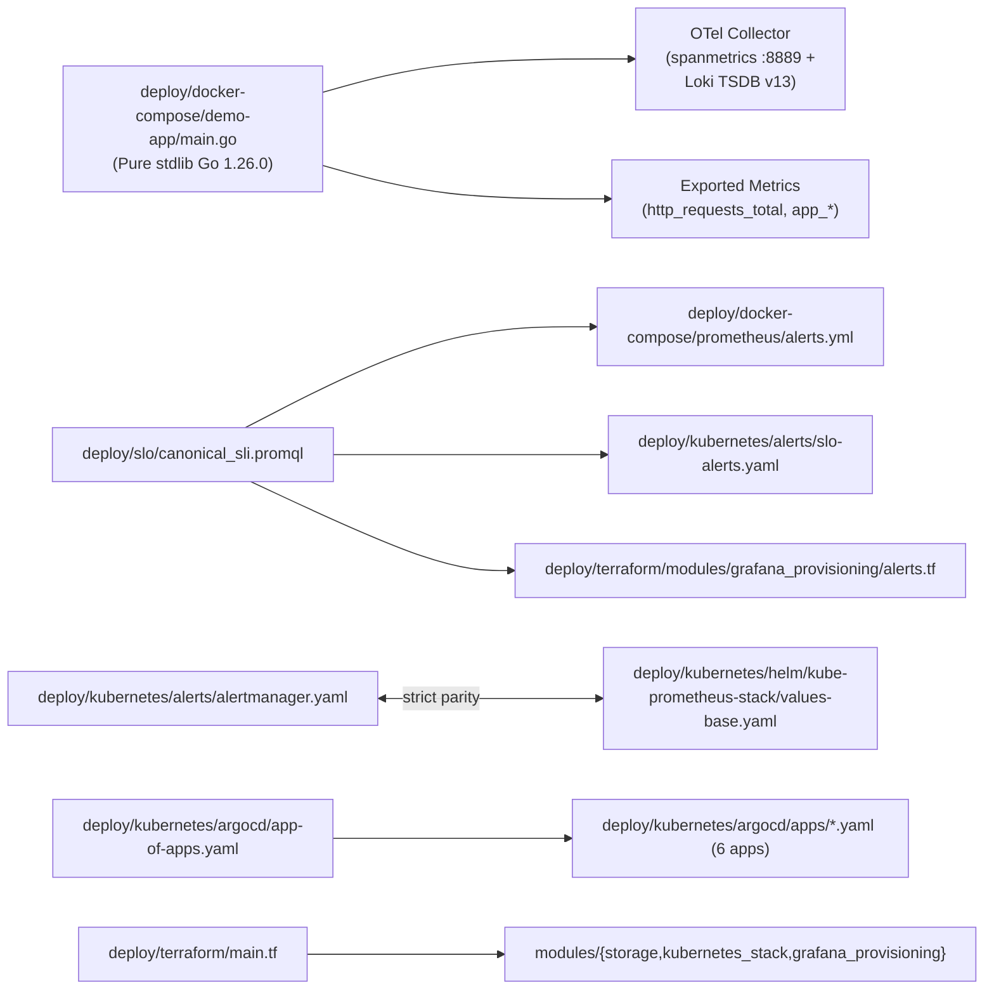

# CodeGraph & Artifact Symbol Index — `cloud-native-observability` (`v0.4.0`)

> **Step 5 of the Mandatory Grounding Order** (`AGENTS.md` -> `ARCHITECTURE.md` -> `docs/FLOWS.md` -> `skills/*/SKILL.md` -> **`docs/CODEGRAPH.md`** -> targeted source reads only for verification).

This deterministic cross-artifact index maps the Go symbols in `deploy/docker-compose/demo-app`, Canonical SLI & PromQL recording/alert symbols, Grafana dashboard metric bindings, ArgoCD App-of-Apps manifests, and Terraform IaC modules for `github.com/abeta-dev/cloud-native-observability` (`v0.4.0`, Go `1.26.0`).

---

## 1. Cross-Artifact Dependency Graph

---

## 2. Go Reference Service Symbol Map (`deploy/docker-compose/demo-app`)

Zero external third-party imports (`100%` Go standard library; verified by `./scripts/check_leaf_imports.sh`, `100.0%` statement coverage).

| Symbol | Kind | Coordinate | Role |
| :--- | :--- | :--- | :--- |
| `Metrics` | struct | `deploy/docker-compose/demo-app/main.go:28` | Atomic counters & histogram buckets exposed at `/metrics` |
| `CircuitBreaker` | struct | `deploy/docker-compose/demo-app/main.go:45` | 3-state circuit breaker emitting `app_circuit_breaker_*` metrics |
| `(*CircuitBreaker).RecordFailure` | method | `deploy/docker-compose/demo-app/main.go:81` | Failure tracking & Closed -> Open trip transition |
| `(*CircuitBreaker).RecordSuccess` | method | `deploy/docker-compose/demo-app/main.go:115` | Success tracking & HalfOpen -> Closed recovery |
| `(*CircuitBreaker).AllowRequest` | method | `deploy/docker-compose/demo-app/main.go:138` | Request admission gate & state gauge reporting |
| `(*CircuitBreaker).CheckWatchdog` | method | `deploy/docker-compose/demo-app/main.go:161` | Open -> HalfOpen cooldown transition check |
| `(*CircuitBreaker).StartWatchdog` | method | `deploy/docker-compose/demo-app/main.go:178` | Background state watchdog ticker |
| `sendOTLPLog` | func | `deploy/docker-compose/demo-app/main.go:278` | OTLP HTTP log export with `trace_id`/`span_id` correlation |
| `sendOTLPSpan` | func | `deploy/docker-compose/demo-app/main.go:361` | OTLP HTTP trace span export to collector `:4318` |
| `withInstrumentation` | func | `deploy/docker-compose/demo-app/main.go:422` | HTTP RED middleware (trace, logs, duration buckets) |
| `handleItems` | func | `deploy/docker-compose/demo-app/main.go:476` | Cache hit/miss endpoint (`app_cache_*`) |
| `handleTasks` | func | `deploy/docker-compose/demo-app/main.go:491` | Bounded workerpool endpoint (`app_workerpool_*`) |
| `handleQuotes` | func | `deploy/docker-compose/demo-app/main.go:534` | Circuit-breaker protected endpoint |
| `handleError` | func | `deploy/docker-compose/demo-app/main.go:572` | Controlled 5xx fault injection for SLO burn testing |
| `handleMetrics` | func | `deploy/docker-compose/demo-app/main.go:594` | Prometheus text-format `/metrics` exposition |
| `newHandler` | func | `deploy/docker-compose/demo-app/main.go:663` | HTTP router assembly |

---

## 3. Canonical SLI, Recording Rules & Alert Parity Map

| Artifact | Path | Enforced Contract |
| :--- | :--- | :--- |
| **Canonical Availability SLI** | `deploy/slo/canonical_sli.promql` | Single source of truth for HTTP `status=~"5.."` error ratio PromQL AST |
| **Docker Compose Alerts** | `deploy/docker-compose/prometheus/alerts.yml` | Must match Canonical SLI AST (`./scripts/test_alerts.sh`) |
| **Kubernetes SLO Alerts** | `deploy/kubernetes/alerts/slo-alerts.yaml` | 5 recording rules (`job:http_requests:error_rate_{5m,30m,1h,6h,3d}`) + `14.4x` (5m/1h), `6.0x` (30m/6h), `1.0x` (6h/3d) |
| **Terraform Grafana Alerts** | `deploy/terraform/modules/grafana_provisioning/alerts.tf` | Must match Canonical SLI AST (`./scripts/check_version.sh`) |
| **Alertmanager Config** | `deploy/kubernetes/alerts/alertmanager.yaml` | Semantically identical to `deploy/kubernetes/helm/kube-prometheus-stack/values-base.yaml` |
| **Incident Runbooks** | `docs/RUNBOOKS.md` | Must cover every firing alert name |

---

## 4. Grafana Dashboard Catalog (`deploy/docker-compose/grafana/dashboards/`)

| Dashboard JSON | Primary Metrics Queried |
| :--- | :--- |
| `microservice-golden-signals.json` | `http_requests_total`, `http_request_duration_seconds_bucket`, `job:http_requests:error_rate_*` |
| `microservice-apm.json` | `traces_spanmetrics_calls_total`, `traces_spanmetrics_duration_milliseconds_bucket`, `app_circuit_breaker_*`, `app_workerpool_*`, `app_cache_*` |
| `logs-explorer.json` | Loki TSDB `v13` streams correlated by structured metadata (`trace_id`, `span_id`, `request_id`) |
| `platform-overview.json` | `up`, `prometheus_tsdb_head_series`, `loki_ingester_memory_chunks`, `tempo_ingester_blocks_active`, `otelcol_process_memory_rss` |

---

## 5. GitOps (ArgoCD) & Terraform IaC Index

- **ArgoCD Root App**: `deploy/kubernetes/argocd/app-of-apps.yaml` (`targetRevision: v0.4.0`)
- **ArgoCD Child Apps (`deploy/kubernetes/argocd/apps/`)**:
  - `kube-prometheus-stack.yaml`, `loki-stack.yaml`, `tempo-stack.yaml`, `otel-collector.yaml`, `observability-alerts.yaml`, `secrets.yaml`
- **Terraform Root & Modules (`deploy/terraform/`)**:
  - Root entrypoint: `deploy/terraform/main.tf`
  - `deploy/terraform/modules/storage/main.tf`
  - `deploy/terraform/modules/kubernetes_stack/main.tf`
  - `deploy/terraform/modules/grafana_provisioning/main.tf` (+ `alerts.tf`)
- **Local Semantic Graph (Optional)**: `graphify-out/GRAPH_REPORT.md` & `graphify-out/graph.json` (gitignored local cache).
