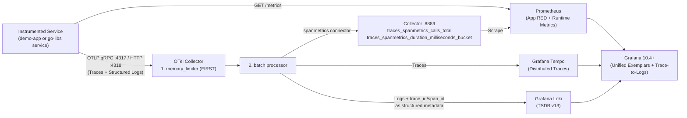
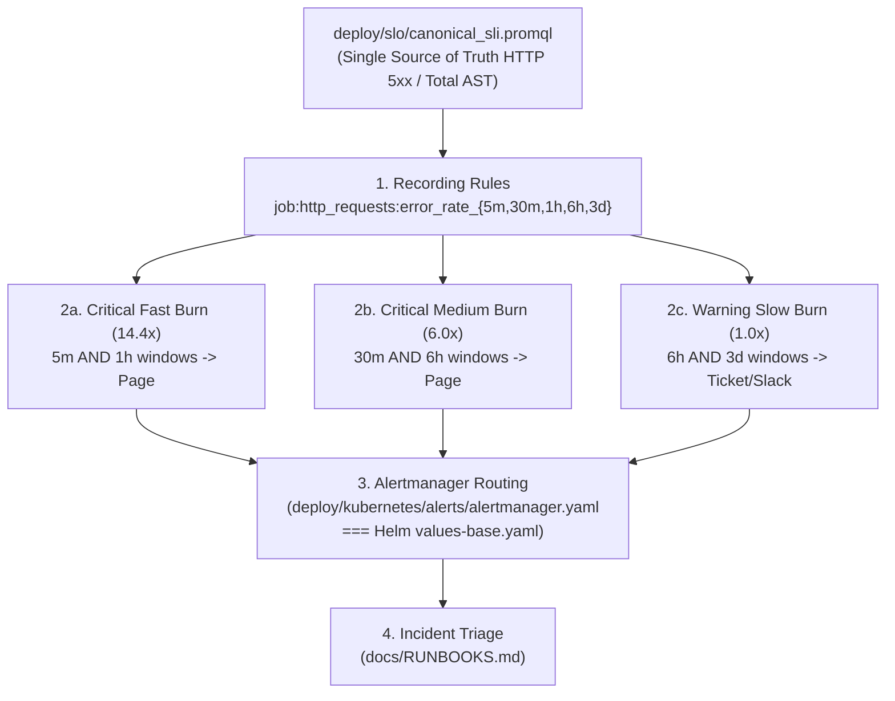

# End-to-End Execution Flows — `cloud-native-observability` (`v0.4.0`)

> **Step 3 of the Mandatory Grounding Order** (`AGENTS.md` -> `ARCHITECTURE.md` -> **`docs/FLOWS.md`** -> `skills/*/SKILL.md` -> `docs/CODEGRAPH.md` -> targeted source reads only for verification).

This document traces the five core telemetry, SLO alerting, GitOps, Infrastructure-as-Code, and truth-gate flows across `github.com/abeta-dev/cloud-native-observability` (`v0.4.0`, Go `1.26.0`).

---

## 1. Telemetry Ingestion & Correlation Flow (OTel Collector -> LGTM)

### Flow Invariants
- **`memory_limiter` is always the first processor** in every OTel Collector pipeline (`traces`, `metrics`, `logs`) to prevent OOM cascades under traffic bursts.
- **Loki TSDB `v13` cardinality guardrail**: High-cardinality IDs (`trace_id`, `span_id`, `request_id`) flow into Loki **structured metadata**, never into indexed stream labels.
- **Spanmetrics contract**: RED latency and call metrics from traces are exported on `:8889` as `traces_spanmetrics_calls_total` and `traces_spanmetrics_duration_milliseconds_bucket`.

---

## 2. Canonical Availability SLI -> Multi-Window Burn-Rate Alerting Flow

- **Cross-deployment AST equivalence**: `./scripts/test_alerts.sh` and `./scripts/check_version.sh` verify that `deploy/slo/canonical_sli.promql`, Docker Compose alerts (`deploy/docker-compose/prometheus/alerts.yml`), Kubernetes alerts (`deploy/kubernetes/alerts/slo-alerts.yaml`), and Terraform alerts (`deploy/terraform/modules/grafana_provisioning/alerts.tf`) share the exact same canonical error-ratio PromQL AST.

---

## 3. Kubernetes GitOps Delivery Flow (ArgoCD App-of-Apps + Helm Overlays)

1. Root application [`deploy/kubernetes/argocd/app-of-apps.yaml`](../deploy/kubernetes/argocd/app-of-apps.yaml) tracks release tag `v0.4.0`.
2. Child `Application` manifests under `deploy/kubernetes/argocd/apps/` reconcile:
   - `kube-prometheus-stack` (Prometheus, Alertmanager, Grafana)
   - `loki`, `tempo`, `opentelemetry-collector`
   - `observability-alerts` (SLO recording rules, burn-rate alerts, Alertmanager config)
3. Each chart layers base values (`deploy/kubernetes/helm/*/values-base.yaml`) with cloud-specific overlays (`values-eks.yaml`, `values-gke.yaml`) and strict `NetworkPolicy` isolation (`deploy/kubernetes/network-policies/`).

---

## 4. Three-Layer Terraform Observability-as-Code Flow (`deploy/terraform/`)

1. **`modules/storage`**: Provisions S3 / GCS object storage buckets and IAM/workload-identity bindings for Loki chunks, Tempo blocks, and Thanos/Prometheus long-term storage.
2. **`modules/kubernetes_stack`**: Deploys Helm releases (Prometheus stack, Loki, Tempo, OpenTelemetry Collector) referencing storage module outputs.
3. **`modules/grafana_provisioning`**: Provisions Grafana folders, 4 validated dashboards (`microservice-golden-signals`, `microservice-apm`, `logs-explorer`, `platform-overview`), and canonical SLO alert rules (`alerts.tf`).

---

## 5. Pre-Commit & CI Truth-Gate Verification Flow

1. `./scripts/check_secrets.sh` — TruffleHog verified git history + static secret/DSN scan.
2. `./scripts/check_leaf_imports.sh` — Confirms `deploy/docker-compose/demo-app` remains 100% pure Go standard library (`0` third-party dependencies).
3. `./scripts/check_deprecation.sh` — Enforces strict `N + 2` deprecation window formatting.
4. `./scripts/check_version.sh` — Validates `v0.4.0` parity across `README.md`, `CHANGELOG.md`, `AGENTS.md`, `skills/*/SKILL.md`, ArgoCD manifests, Grafana dashboard metric catalogs, and documentation claims.
5. `./scripts/test_alerts.sh` — Validates PromQL AST equivalence and Alertmanager standalone/Helm parity.
6. `(cd deploy/docker-compose/demo-app && go test -race -cover ./...)` — Enforces `100.0%` statement coverage with zero data races.
